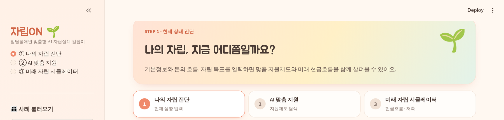
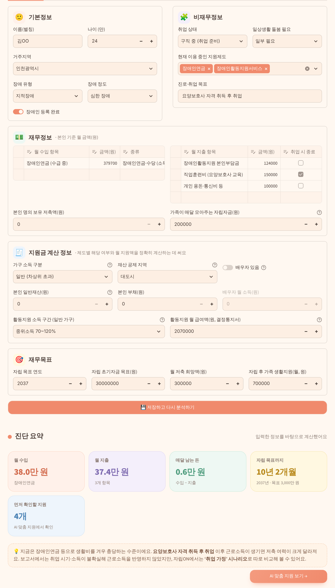
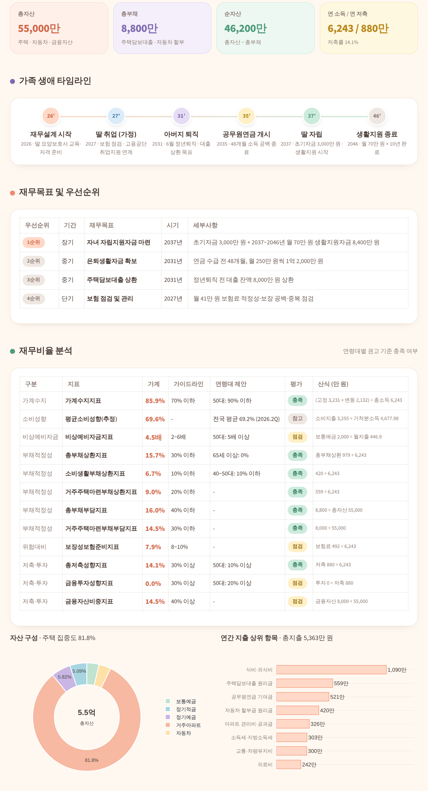
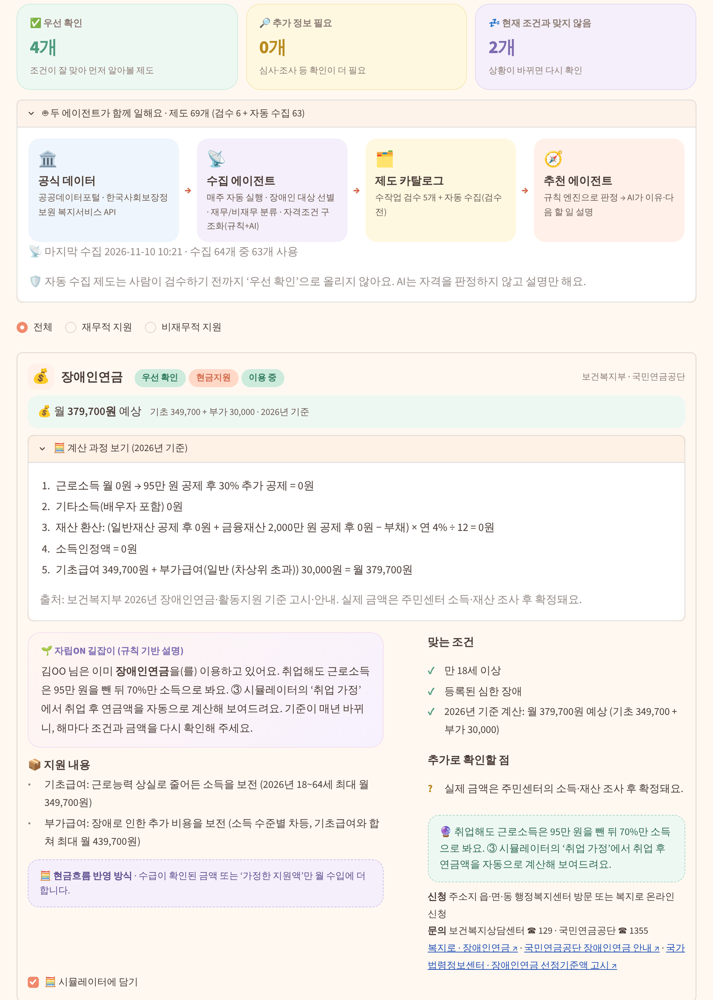
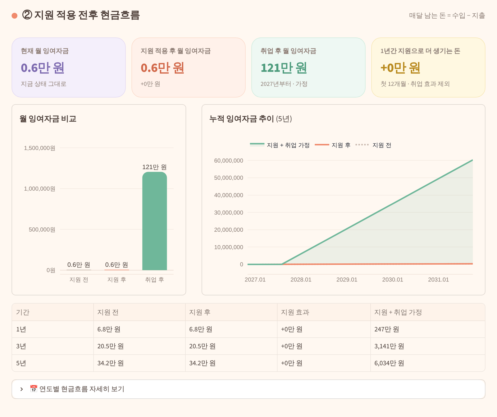
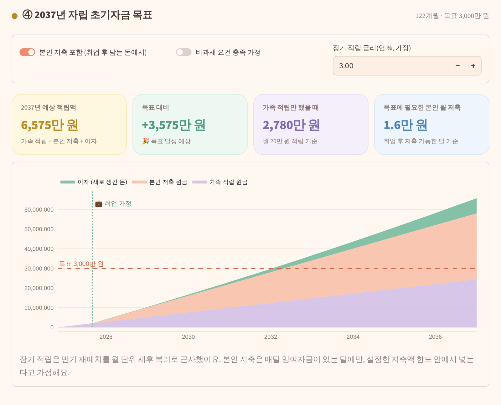
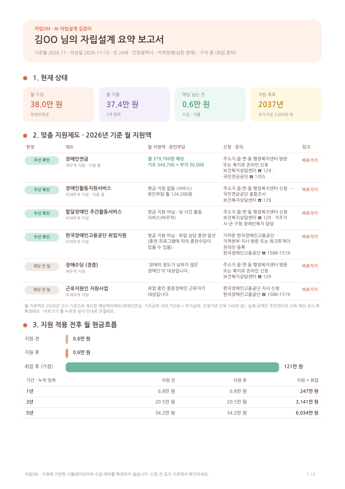

# 자립ON 🌱 — 발달장애인 맞춤형 AI 자립설계 길잡이

AFPK 영 플래너 챌린지 · 4일 개발 MVP

발달장애인의 재무·비재무 정보를 바탕으로 **지원제도를 추천**하고, 지원 적용 전후 **현금흐름 변화**와
잉여자금의 **예금·적금 운용 결과**를 시뮬레이션하는 Streamlit 웹 데모입니다.




## 화면 미리보기

### ① 나의 자립 진단
기본정보, 재무정보, 지원금 계산 정보, 자립 목표를 입력하면 진단 요약이 바로 나와요.



### 🏠 우리 가족 재무상태 (AFPK 3단계 분석)
보고서의 자산부채상태표와 현금흐름표 원자료로 재무비율 12개를 다시 계산하고, 생애 타임라인과 재무목표를 함께 보여줘요.



### ② AI 맞춤 지원
수집 에이전트와 추천 에이전트가 함께 일해요. 제도마다 2026년 기준 **월 예상 지원액**과 계산 과정, 해당 여부, 신청 방법을 보여줘요.



### ③ 미래 자립 시뮬레이터
지원 전과 후, 취업 가정의 월 잉여자금과 누적 현금흐름을 비교해요.



2037년 자립 초기자금 목표를 가족 적립, 본인 저축, 이자로 나눠서 보여줘요.



### 📄 자립설계 요약 PDF
현재 상태, 제도별 월 지원액(공식 링크 포함), 현금흐름, 예·적금, 자립 목표, 점검표를 한눈에 정리한 보고서를 내려받을 수 있어요.



## 화면 구성

| 화면 | 내용 |
| --- | --- |
| ① 나의 자립 진단 | 기본·비재무·재무정보·재무목표 입력 / **우리 가족 재무상태 탭** (AFPK 3단계 재무비율 12개를 원자료에서 재계산, 타임라인·SWOT) |
| ② AI 맞춤 지원 | 5개 제도 규칙 기반 판정(우선 확인 / 추가 정보 필요 / 현재 조건과 맞지 않음), AI 추천 이유, 신청·문의 링크, 중복 이용 주의, AI Q&A |
| ③ 미래 자립 시뮬레이터 | 지원 전후·취업 가정 현금흐름(1·3·5년), 예금·적금·비과세 비교, 2037년 자립 초기자금 목표 추적, 자립 이후 월 수지, AI 쉬운 설명, 모니터링 체크리스트, 요약 다운로드 |

## 공모전 사례 반영 (김OO 님 가족, 2026.10.31 기준)

- 딸: 만 24세, 지적장애(심한 장애), 인천, 요양보호사 취업 준비, **2037년 자립 목표**
- 장애인연금 **수급 중**(연 455만 원 → 월 37.9만 원), 활동지원 **이용 중**(본인부담 연 149만 원)
- 직업훈련비 연 180만 원 → 취업 시 종료 처리
- 부모의 자녀 자립자금 적립 연 240만 원(월 20만 원) → 초기자금 3,000만 원 목표 추적
- 자립 후 가족 생활지원 월 70만 원 × 10년 (8,400만 원)
- 보고서는 딸의 근로소득을 반영하지 않았으므로, 자립ON은 **‘취업 가정’ 시나리오를 따로** 보여줍니다.

## 두 에이전트 구조

```
공공데이터포털 API ──▶ 📡 수집 에이전트 ──▶ 🗂️ 제도 카탈로그 ──▶ 🧭 추천 에이전트 ──▶ 사용자
(한국사회보장정보원      (매주 GitHub Actions)    programs.json (검수 5개)     규칙 판정 → AI 설명
 중앙부처복지서비스)                              programs_collected.json (자동 수집, 검수 전)
```

### 📡 수집 에이전트 (`core/agents/collector.py`)
1. **수집**: 공공데이터포털 「한국사회보장정보원_복지서비스정보」(15083323) 최신 스냅샷을 가져와요. 「중앙부처복지서비스」 API(`--source bokjiro`)도 쓸 수 있어요.
2. **선별**: 장애인 대상 제도만 남기고, 직접 검수한 5개 제도와 이름이 겹치면 빼요.
3. **분류**: 제공유형과 본문으로 현금지원·금융(자산형성) → **재무적 지원**, 돌봄·고용 → **비재무적 지원**으로 나눠요.
4. **구조화**: 지원대상·선정기준 문장에서 나이, 장애유형, 장애정도, 취업상태 조건을 규칙으로 뽑아요. AI가 연결돼 있으면 한 번 더 다듬고, AI 결과는 허용된 키·값만 남기는 검증을 거쳐요.
5. **저장**: `data/programs_collected.json`에 출처(servId, 수집 시각, 추출 방식)와 함께 **검수 전**으로 저장해요.

### 🧭 추천 에이전트 (`core/agents/recommender.py`)
- 수작업 검수 제도와 자동 수집 제도를 합쳐 카탈로그를 만들어요. 이름이 겹치면 검수본이 우선이에요.
- 모든 제도를 같은 규칙 엔진(`core/eligibility.py`)으로 판정해요. 결과는 우선 확인, 추가 정보 필요, 현재 조건과 맞지 않음 중 하나예요.
- **검수 전 제도는 ‘우선 확인’으로 올리지 않아요.** AI는 판정하지 않고 추천 이유와 다음 할 일만 설명해요.
- 질문하면 관련 제도만 골라 근거로 넘겨서 답변해요.

### 수집 에이전트 켜는 법
1. [공공데이터포털](https://www.data.go.kr)에서 「한국사회보장정보원_복지서비스정보」를 활용신청하고 **일반 인증키(Decoding)**를 복사해요. 무료이고, 보통 바로 승인돼요.
2. GitHub 레포 **Settings → Secrets and variables → Actions → New repository secret**에 `DATA_GO_KR_KEY`를 추가해요. AI로 조건을 다듬으려면 `HF_TOKEN`도 추가해요.
3. **Actions → 지원제도 수집 에이전트 → Run workflow**로 바로 실행해요. 이후에는 매주 월요일 새벽에 자동 실행되고, 결과가 커밋되면 Streamlit 앱에 자동 반영돼요.

GitHub Actions 서버는 미국에 있어서 공공데이터포털 접속이 느리거나 끊길 수 있어요. 계속 실패하면 **국내 PC에서 실행**한 뒤 결과 파일을 올리면 돼요.

```powershell
# Windows PowerShell
$env:DATA_GO_KR_KEY="발급받은_Decoding_키"
python -m core.agents.collector --limit 40
git add data/programs_collected.json; git commit -m "지원제도 데이터 갱신"; git push
```

로컬 실행:

```bash
DATA_GO_KR_KEY=... python -m core.agents.collector --limit 40
python -m core.agents.collector --from-dir tests/fixtures/bokjiro --no-llm   # 샘플 응답으로 실행
```

## 2026년 지원금 계산 (`core/benefits.py`)

| 제도 | 계산 | 기준 (2026) |
| --- | --- | --- |
| 장애인연금 | 소득인정액 → 해당 여부 → 기초급여 + 부가급여 | 기초급여 최대 349,700원 · 부가급여 9만/8만/3만 원 · 선정기준 단독 140만·부부 224만 원 · 근로소득 95만 원 공제 후 70% · 재산 연 4% 환산 |
| 장애수당 (경증) | 소득 구분 → 해당 여부 | 기초·차상위 월 6만 원 (보장시설 3만 원) |
| 활동지원 본인부담 | 월 급여액 × 소득 구간 비율 | 생계·의료 면제 · 차상위 2만 원 · 일반 4~10% · 상한 216,200원 |

- 장애인연금은 본인·배우자 소득만 봐요. 그래서 보고서 사례(부모와 사는 딸)는 월 379,700원으로 계산되고, 보고서 현금흐름표의 연 455만 원과 일치해요.
- 시뮬레이터의 ‘취업 가정’은 취업 후 장애인연금을 다시 계산해 자동으로 반영해요.
- 기준값은 `PARAMS_2026`에 출처와 함께 모여 있어요. 매년 1월 고시가 바뀌면 이 값만 고치면 돼요.

## AI 길잡이 · PDF 보고서
- AI 길잡이는 제도 질문뿐 아니라 상속·증여·신탁·후견·세금 질문에도 답해요. 이 사용자의 판정·금액 결과와 `data/knowledge.json`(확인한 법령 핵심 지식)을 근거로 넘겨요.
- ③ 시뮬레이터에서 **자립설계 요약 PDF**를 받을 수 있어요. 현재 상태, 제도별 월 지원액(공식 링크 포함), 현금흐름, 예·적금, 자립 목표, 점검표가 들어가요. 폰트는 나눔고딕(OFL)을 써요.

## 계산 원칙

1. 지원 대상 여부와 실제 수급 확정을 구분합니다. 확인되지 않은 지원금은 ‘가정 시나리오’로 표시합니다.
2. 현금지원만 수입에 더합니다. 돌봄·활동지원은 실제로 줄어든 본인부담만 지출 감소로 반영합니다.
3. 예·적금 납입은 자산의 이동입니다. 순자산을 늘리는 것은 이자뿐입니다.
4. 이미 받고 있는 지원은 중복으로 더하지 않습니다. 중단 시나리오와 장기 가정을 명시합니다.

자격 판정·재무 계산·이자 계산은 Python(`core/`)이 하고, AI는 설명·질의응답만 맡습니다.

## 실행

```bash
pip install -r requirements.txt
streamlit run app.py
```

### AI 연결 (자동 선택)

키가 있는 서비스만 아래 순서로 시도하고, 모두 안 되면 **규칙 기반 설명**으로 바뀌어요. 이때도 모든 기능은 정상 작동해요.

| 순서 | Secrets 키 | 서비스 · 모델 후보 | 비용 |
| --- | --- | --- | --- |
| 1 | `OPENAI_API_KEY` | OpenAI · gpt-4o-mini | 유료 |
| 2 | `GEMINI_API_KEY` | Google Gemini · gemini-2.5-flash 등 | 무료 사용량 |
| 3 | `GROQ_API_KEY` | Groq · gpt-oss-20b, Llama-3.1-8B 등 | 무료 사용량 |
| 4 | `HF_TOKEN` | Hugging Face · Llama-3.1-8B, Qwen3.5-9B 등 | 크레딧 필요 |

- 서비스마다 모델 후보를 순서대로 시도하고, 처음 성공한 모델을 계속 써요. `GEMINI_MODEL`처럼 `<서비스>_MODEL`로 고정할 수도 있어요.
- 키 오류나 크레딧 없음(402)은 그 서비스만 건너뛰고 다음 서비스로 넘어가요.
- `python scripts/ai_check.py` 또는 GitHub Actions의 **AI 연결 점검**으로 키 권한과 모델별 응답을 확인할 수 있어요.

테스트 (보고서의 재무비율 12개, 기획서 예시 +420만 원, 적금 이자, 추천 규칙 검증):

```bash
python -m pytest -q
```

## 배포 (Streamlit Community Cloud)

GitHub에 올린 뒤 share.streamlit.io에서 `app.py`를 지정하고, Settings → Secrets에 `OPENAI_API_KEY` 또는 `HF_TOKEN`을 입력합니다.

## 구조

```
app.py                 화면 3개 · 라우팅
core/finance.py        현금흐름 · 예금 · 적금 · 목표 계산
core/eligibility.py    조건(criteria) 기반 범용 판정 엔진 · 중복 경고
core/agents/collector.py   수집 에이전트 (공공데이터 → 구조화)
core/agents/recommender.py 추천 에이전트 (판정 · 설명 · 질의응답)
core/household.py      가족 재무비율 (AFPK 3단계)
core/ai.py             AI 설명 · Q&A (OpenAI → Hugging Face → 규칙 기반)
core/ui.py             파스텔 테마 CSS · 컴포넌트
data/programs.json     수작업 검수 지원제도 5개 (구조화된 자격조건 포함)
data/programs_collected.json  수집 에이전트 결과 (검수 전)
data/personas.json     공모전 사례 · 예시 사용자
tests/                 계산 · 판정 · 에이전트 테스트 (샘플 API 응답 포함)
```

> 지원 내용·금액·기준은 매년 바뀝니다. 이 서비스는 수급 여부를 확정하지 않습니다.
